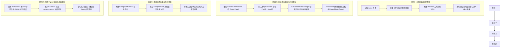

# 小智 Android 具身桌宠客户端选型与二次开发方案

本项目文档记录了将闲置的 **小米 6X（Mi 6X）** 改造为 **AI Agent 具身桌面宠物（桌宠）** 的客户端技术选型理由、现有工程优势与源码审计、长期二次开发演进方向以及基于 GitHub Actions 的持续交付（CI/CD）自动化编译流程。

---

## 1. 硬件载体与系统环境

* **设备型号**：小米 6X（代号：`wayne`）
* **处理器 / GPU**：高通骁龙 660（SDM660，4×Kryo 260 Gold 2.2GHz + 4×Kryo 260 Silver 1.8GHz，Adreno 512 GPU）
* **内存 / 存储**：4GB / 6GB LPDDR4X + 32GB / 64GB / 128GB eMMC 5.1
* **屏幕规格**：5.99 英寸 IPS LCD，1080×2160 分辨率（18:9 比例，极佳的桌面立式纵览视口）
* **操作系统**：`LineageOS 21.0-20250509-UNOFFICIAL-wayne`（Android 14，API Level 34）
* **传感器与外设**：前置 20MP 摄像头（用于桌面视觉感知）、顶部降噪麦克风 + 底部主麦克风、底部单扬声器、Type-C 接口（用于桌面底座长期供电）

---

## 2. 仓库选型与背景分析

### 2.1 选定仓库
* **上游仓库**：[xiaoniu/xiaozhi-ai-android](https://github.com/xiaoniu/xiaozhi-ai-android)
* **二次开发主干仓库**：[tayhe/xiaozhi-ai-android](https://github.com/tayhe/xiaozhi-ai-android)
* **副本澄清**：社区中的 `by-kobayashi/xiaozhi-ai-android` 经代码比对，为上游 `xiaoniu` 的 1:1 镜像 Fork（未做独立提交，`ahead 0, behind 0`），二次开发统一以 `tayhe/xiaozhi-ai-android` 为主干。

### 2.2 横向选型对比

在小智开源生态的各类客户端中，针对“具身桌宠”这一特定形态的选型对比如下：

| 评估维度 | **`xiaoniu/xiaozhi-ai-android`（选定）** | `jerrygugu/xiaozhi-android` | `TOM88812/xiaozhi-android-client` |
| :--- | :--- | :--- | :--- |
| **技术栈** | **Kotlin + Jetpack Compose + NDK C++** | Kotlin + Jetpack Compose + Oboe C++ | Flutter (Dart) |
| **音频引擎** | **NDK 编译原生 Opus 1.3.1**，直接对接小智音频帧 | Oboe C++ 播放，录音链路较基础 | 依赖 Flutter 插件，多层抽象有抖动开销 |
| **回声消除 (AEC)** | **系统级硬件 `AcousticEchoCanceler`** | 无完善封装 | 跨平台插件在部分 Android 驱动上不稳定 |
| **UI 交互形态** | **全屏语音拟态波形球（视口中心化）** | 传统 IM 列表（聊天气泡 + 底部输入框） | 综合手机 App（多 Tab、列表、设置抽屉） |
| **端侧 MCP 工具** | **具备规范文档与框架打桩**（需在客户端补全调度器） | 无 | 侧重 IoT 与 Dify 平台集成 |
| **扩展桌宠阻力** | **极低**（Compose 原生模块解耦清晰，直接嵌 Live2D） | 较低（但需自行补全音频协议细节） | 较高（需跨 Dart/C FFI/Android 处理） |

---

## 3. 选定项目的核心技术优势与源码审计

经过对工程源码各层实现的全面审计，项目的核心技术特征及实际代码状况如下：

### 3.1 原生 NDK Opus 编解码与声学链路
* **源码实现**：
  * C++ 原生构建通过 Prefab 引入官方预编译的 `opus 1.3.1`（`com.fpliu.ndk.pkg.prefab.android.21:opus`），在 `CMakeLists.txt` 中直接链接 `opus::libopus.so`。
  * 原生 JNI 源码位于 `app/src/main/cpp/opus_recorder.cpp`（对应 `OpusEncoder.kt`）与 `opus_decoder.cpp`（对应 `OpusDecoder.kt`）。
  * 严格对齐小智 ESP32 服务端规范：16kHz 录音编码、24kHz 播放解码、60ms Opus 帧（每帧 960 个短整型样本），无冗余重采样开销。

### 3.2 彻底解决桌面外放自扰问题（系统级 AEC 回声消除）
* 具身桌宠需长时间依靠扬声器大音量外放，若无硬件级 AEC，扬声器声音会被麦克风录回引发误打断（Barge-in 死循环）。
* 该项目在 `EnhancedAudioManager.kt` 中：
  * 音频录音源显式选用 `MediaRecorder.AudioSource.VOICE_COMMUNICATION`；
  * 基于 `record.audioSessionId` 创建并启用了系统的 `AcousticEchoCanceler` 与 `NoiseSuppressor`，免除了二次开发最复杂的底层声学回声消除算法调试。

### 3.3 天然契合“桌宠视口”的全屏拟态 UI
* 采用 Aetheric Harmony 玻璃拟态设计，布局以右上角字幕开关分为两态：
  * `showSubtitles == false`（默认态）：展示 `CenterPanel`，中心为一个带呼吸缩放（`scale` 0.96~1.04）的 240dp 圆形拟态视口（原放置豆包头像），下方为状态文字；
  * `showSubtitles == true`：展示气泡对话列表 `MessageList`。
* 这种结构天然为替换 Live2D/3D 虚拟形象留出了完美插槽，无需推倒原有 UI 骨架。

### 3.4 源码审计发现的预判偏差（重点排雷）

> [!WARNING]
> **排雷点 1：端侧 MCP 在客户端目前仅为“规范文档”，业务逻辑尚未真正实现**
> * 现状：虽然仓库中包含 `doc/mcp.md` 并设计了完整的交互时序，且定义了 `WebSocketEvent.MCPMessage`，但在当前 `WebSocketManager.kt` 的 `sendHelloMessage()` 中，**并未携带 `features: {"mcp": true}`**。且 WebSocket 接收处从未派发过 `MCPMessage` 事件，`ConversationViewModel.kt` 中也没有解析 `"type": "mcp"` 的分支。
> * 对策：阶段四若要驱动前置摄像头拍照、系统设置调控等能力，必须在客户端补充 JSON-RPC 2.0 请求响应调度器。

> [!CAUTION]
> **排雷点 2：官方 OTA 接口会自动强制覆盖用户自定义的 WebSocket URL**
> * 现状：查阅 `ConversationViewModel.kt`，用户点击通话时会触发 `performOtaCheck()`。若配置中保留有默认官方 OTA 地址（`https://api.tenclass.net/xiaozhi/ota/`），OTA 请求成功后会执行 `updateWebSocketUrl(otaResponse.websocket.url)`，**导致用户手动填写的 Instabox 等自建 WSS 地址被瞬间冲刷覆盖**。
> * 对策：连接自建服务时，必须将客户端设置中的 OTA 地址留空，或在 `ConversationViewModel.kt` 中增加保护逻辑：优先使用本地手动配置的 WSS，不被 OTA 强制篡改。

> [!NOTE]
> **排雷点 3：Lip-sync 缺失实时 PCM 音频振幅（Volume/RMS）数据流**
> * 现状：`EnhancedAudioManager.kt` 解码出 PCM 后直接推送到底层 `OpusStreamPlayer` 播放，尚未向外部 StateFlow 广播音频振幅。
> * 对策：需在 PCM 解码循环中加入 RMS 能量算法，通过 `StateFlow<Float>` 暴露给 UI / WebView 以驱动 Live2D 嘴形开合参数。

---

## 4. 具身桌宠二次开发演进方向（Roadmap）

本项目作为二次开发底座，将按照以下四个阶段逐步升级为完整的具身桌面伴侣：



### 4.1 阶段一：云端小智服务端直连验证（已全面完成并通过实测）
1. **网络端点对接**：
   * **WebSocket 对话端点**：`wss://8989-agqw4kesptakygogg4l7hqpaei.instabox.tech/xiaozhi/v1/`
   * **视觉识别端点**：`https://8989-agqw4kesptakygogg4l7hqpaei.instabox.tech/xiaozhi/api/vision`
2. **防覆盖策略实装**：
   * 在 `ConversationViewModel.kt` 中完善防护，仅在本地 WSS 为空时才采纳 OTA 返回的地址，保证自建云端服务配置持久生效。
3. **声学实测与排障**：
   * 在小米 6X（LineageOS 21，Android 14）上完成端到端全链路双向通话验证：
   * 麦克风录音 -> 阿里云千问 ASR 毫秒级上屏 -> Magpie mimo-v2.6-pro 大脑推理 -> 阿里云千问 TTS 流式下发 -> 底部大音量扬声器完整播放 156,960 帧（完整 6.54 秒清晰语音）-> 预留 300ms 混响消除后平滑切回录音。硬件级 AEC 工作良好，无声学自激。

### 4.2 阶段二：虚拟形象（Avatar）与口型/情感联动
1. **Live2D 视口嵌入**：
   * 在 Compose 中将原本的 `CenterPanel` 头像区域替换为 `AndroidView`，承载本地透明背景的 `WebView`。
   * Web 端集成成熟轻量的 `pixi-live2d-display`，模型资源内置于 `app/src/main/assets/live2d/`。
2. **实时口型同步（Lip-sync）**：
   * 在 `EnhancedAudioManager.kt` 解码出 PCM 数据后，增加分贝/RMS 能量计算：
     ```kotlin
     fun calculateRms(pcmData: ByteArray): Float {
         var sum = 0.0
         val sampleCount = pcmData.size / 2
         for (i in 0 until sampleCount) {
             val sample = (pcmData[i * 2].toInt() and 0xFF) or (pcmData[i * 2 + 1].toInt() shl 8)
             sum += sample.toShort() * sample.toShort()
         }
         return kotlin.math.sqrt(sum / sampleCount).toFloat() / 32768f
     }
     ```
   * 通过 `audioVolume: StateFlow<Float>` 广播能量值，通过 `@JavascriptInterface` 注入 WebGL 动态驱动 `ParamMouthOpenY`。
3. **情绪与动作状态机**：
   * `ConversationViewModel` 已在收到 LLM 消息时提取了 `emotion` 字段。将其结合 `ConversationState`（`LISTENING`、`PROCESSING`、`SPEAKING`、`IDLE`）透传给 WebView，触发歪头、思考、倾听或眨眼动作。

### 4.3 阶段三：离线远场语音唤醒（Sherpa-ONNX）
1. **常驻前台服务**：
   * 创建 `XiaozhiForegroundService`，声明 `FOREGROUND_SERVICE_MICROPHONE` 权限，避免应用在后台或灭屏时被 Android 14 系统杀死。
2. **轻量离线唤醒模型**：
   * 接入新一代 Kaldi 轻量端侧引擎 **Sherpa-ONNX**，加载体积仅数 MB 的轻量级中文关键词检测（KWS）模型（唤醒词：“小智” / “你好小智”）。
   * 骁龙 660 单核 CPU 占用低于 3%，发热与功耗极低。
3. **麦克风音频流管道分发**：
   * 待机模式：麦克风音频流独占喂给 Sherpa-ONNX；
   * 触发唤醒后：自动平滑切换至 `EnhancedAudioManager`，发起 WebSocket 对话连接并推流。

### 4.4 阶段四：物理 Agent 感知与桌面常驻适配
1. **补全端侧 MCP 调度器**：
   * 在 `WebSocketManager.sendHelloMessage()` 中补全 `features: {"mcp": true}`；
   * 完善 `handleTextMessage()`，解析 `"type": "mcp"` 下的 JSON-RPC 2.0 报文；
   * 注册本地工具清单：`self.get_device_status`（电量、亮屏、网络）、`camera.capture`（环境感知拍照）。
2. **CameraX 视觉抓拍**：
   * 绑定前置 20MP 摄像头，当收到服务端的 `tools/call: camera.capture` 时，静默抓拍一帧并通过小智 Vision API 上传分析。
3. **桌面底座适配（Kiosk Mode）**：
   * 窗口设置 `FLAG_KEEP_SCREEN_ON`，插电时保持常亮；
   * 监听 `ACTION_POWER_CONNECTED`：插入桌面供电底座时自动唤醒主界面；断电后自动息屏降频进入低功耗监听模式。

---

## 5. GitHub Actions 自动化编译与持续交付

为了避免在本地电脑或云端轻量容器中配置庞大的 Android NDK、CMake 及 Android SDK 构建环境（至少占用 8~12GB 磁盘），本项目全面采用 **GitHub Actions** 进行自动化云端编译。

### 5.1 工作流配置文件
项目工作流位于：[`.github/workflows/build-apk.yml`](../.github/workflows/build-apk.yml)

核心构建脚本（已针对 Runner 环境预装 NDK 动态适配优化）：

```yaml
name: Build Android APK

on:
  push:
    branches: [ "main" ]
  pull_request:
    branches: [ "main" ]
  workflow_dispatch: # 支持在 GitHub 网页手动点击触发构建

jobs:
  build:
    name: Assemble Debug APK
    runs-on: ubuntu-latest

    steps:
      - name: Checkout Repository
        uses: actions/checkout@v4
        with:
          submodules: recursive

      - name: Set up JDK 17
        uses: actions/setup-java@v4
        with:
          distribution: 'temurin'
          java-version: '17'

      - name: Setup Gradle
        uses: gradle/actions/setup-gradle@v3

      # 动态配置与 AGP 兼容的 Android NDK 并同步版本号
      - name: Configure Android NDK
        run: |
          echo "Available NDKs in $ANDROID_SDK_ROOT/ndk:"
          ls -la $ANDROID_SDK_ROOT/ndk/ || true
          TARGET_NDK=$(ls -d $ANDROID_SDK_ROOT/ndk/27.* 2>/dev/null | tail -n 1)
          if [ -z "$TARGET_NDK" ]; then
            TARGET_NDK=$(ls -d $ANDROID_SDK_ROOT/ndk/26.* 2>/dev/null | tail -n 1)
          fi
          if [ -z "$TARGET_NDK" ]; then
            TARGET_NDK=$(ls -d $ANDROID_SDK_ROOT/ndk/* 2>/dev/null | sort -V | tail -n 1)
          fi
          NDK_VER=$(basename "$TARGET_NDK")
          echo "Selected NDK: $NDK_VER at $TARGET_NDK"
          echo "ANDROID_NDK_HOME=$TARGET_NDK" >> $GITHUB_ENV
          echo "ANDROID_NDK_VERSION=$NDK_VER" >> $GITHUB_ENV
          echo "ndk.dir=$TARGET_NDK" >> local.properties

      - name: Grant Execute Permission to Gradlew
        run: chmod +x gradlew

      - name: Build with Gradle
        run: ./gradlew assembleDebug --stacktrace

      - name: Upload APK Artifact
        uses: actions/upload-artifact@v4
        with:
          name: xiaozhi-ai-debug-apk
          path: app/build/outputs/apk/debug/*.apk
          retention-days: 7
```

### 5.2 编译与真机部署步骤
1. 将本地修改推送至 [tayhe/xiaozhi-ai-android](https://github.com/tayhe/xiaozhi-ai-android)。
2. 在 GitHub 仓库页面点击 **Actions**，观察流水线构建日志（NDK C++ 编译与 Gradle 打包通常在 2~3 分钟内完成）。
3. 构建成功后，在 **Artifacts** 区域下载 `xiaozhi-ai-debug-apk`。
4. 安装到小米 6X 真机后，授予麦克风与网络权限即可开始调试。

---

## 6. 全双工语音实战沉淀与排障手册（Troubleshooting & Lessons Learned）

本章节系统性沉淀在二次开发首期过程中，围绕**小米 6X 真机、Instabox 自建小智服务端、阿里云百炼 ASR/TTS、Magpie 大模型网关**全链路联调时遇到的核心故障与解决方案。

### 6.1 故障一：客户端“听不到声音 / 回答被截断”深度复盘
* **表象特征**：手机界面显示“正在思考 -> 正在回答”，但扬声器几乎没有声音，仅仅听到短促的杂音或前 0.1 秒，紧接着界面又跳回“正在倾听...”。
* **根本原因分析**：
  1. **状态机提前中止错误**：小智协议中服务端下发的 `{"type":"tts", "state":"stop"}` 仅代表**服务端文本生成推流完毕**。原工程在收到该消息时立即调用了 `audioManager.stopPlaying()`，直接清空了 `AudioTrack` 硬件缓冲区并取消了解码协程（抓包和日志分析显示只播放了前 120ms，剩余 95% 的音频帧被全部丢弃）。
  2. **录音抢断与回声自激**：原工程在调用 `stopPlaying()` 后紧接着执行了 `startNextRound()`，瞬间开启麦克风向服务端上报 `listen: start`，声学状态机直接打断了正在进行的播报并重置。
  3. **未显式绑定扬声器外放**：Android 系统在录音源为 `VOICE_COMMUNICATION` 时会进入通话模式，默认将声音路由至机身顶部微弱的**听筒（Earpiece）**而非底部扬声器。
* **解决方案与代码沉淀**：
  * 在 `OpusStreamPlayer.kt` 中实现 `waitForPlaybackCompletion()`：实时累计已写入的 PCM 采样总帧数 `totalWrittenFrames`，与底层硬件播放头 `AudioTrack.playbackHeadPosition` 进行高精度比对，确保每一帧音频彻底播放到最后一毫秒。
  * 在 `ConversationViewModel.kt` 中引入 `handleTtsStop()`：收到服务端的 TTS `stop` 事件后，异步挂起等待客户端彻底播放完，额外预留 300ms 混响衰减缓冲期，待喇叭彻底静音后再切回麦克风录音；同时保留用户随时主动打断（interrupt）功能。
  * 在 `OpusStreamPlayer.kt` 中强制扬声器外放：显式设置 `audioManager.isSpeakerphoneOn = true`，并在 Android 12+ (API 31+) 上调用 `am.setCommunicationDevice(speakerDevice)`。

### 6.2 故障二：服务端 EdgeTTS 握手失败与千问 TTS 迁移
* **表象特征**：服务端生成了 LLM 文字并通过 WebSocket 推送了 `sentence_start`/`sentence_end`，但客户端实际上收到 0 个二进制音频帧。
* **根本原因分析**：
  * 微软 EdgeTTS 官方近期强化了反爬风控策略（强制校验带时间戳的 `Sec-MS-GEC` 签名头）。
  * Go 服务端内部依赖的第三方库 `github.com/difyz9/edge-tts-go` 缺少该鉴权算法，导致与微软服务器握手抛出 `websocket: bad handshake`，进而静默丢弃音频。
* **解决方案与配置沉淀**：
  * 将 Instabox 服务端的 TTS 切换为内置且已打通的阿里云百炼大模型语音合成（`aliyun_qwen` / `qwen3-tts-flash`，音色 `Cherry`），与已配置的千问 ASR 共享已有的 DashScope 凭证。
  * 实测首帧到达延迟低于 420ms，合成音质清脆自然，彻底杜绝了第三方接口失效的风险。

### 6.3 故障三：流式音频传输从 Flow 到 Channel 的重构
* **表象特征**：在快速多包突发到达时，可能出现音频分片播放乱序、跳音或协程挂起死锁。
* **根本原因分析**：
  * 原代码在 `EnhancedAudioManager.kt` 中使用 `_audioPlaybackFlow = MutableSharedFlow<ByteArray>()`（无缓冲配置），并且每个网络包都会启动一个新的协程并发 `emit`。在底层 `audioTrack.write` 阻塞写入时，多个并发协程恢复的顺序在 Dispatchers.IO 调度器下不保证 FIFO。
* **解决方案与代码沉淀**：
  * 改用无界 `Channel<ByteArray>(Channel.UNLIMITED)` 作为音频接收队列，保障严格的 FIFO 先进先出顺序；
  * 由专一的后台消费协程按顺序逐帧取出、Opus 解码并推入 AudioTrack，彻底杜绝丢包与乱序。

### 6.4 故障四：OTA 接口自动覆盖自定义配置防范
* **表象特征**：在客户端配置了自建的 Instabox WSS 地址后，每次点击通话后会被自动重写为官方公共服务器地址。
* **解决方案与代码沉淀**：
  * 在 `ConversationViewModel.kt` 的 `performOtaCheck()` 中加入保护性校验：仅当本地配置的 `config.websocketUrl.isBlank()` 时才允许采纳 OTA 下发的推荐地址，保障用户自建服务的优先级。

### 6.5 故障五：麦克风 ALSA 零散分片被丢弃导致的 ASR 仅识别“嗯”与 LLM 机械复读
* **表象特征**：用户说话时小智没有任何反应，假装倾听一段时间后，自顾自重复说同一段机械话术（如：“厚！你是只会说嗯的机器人喔？下次约会带我去看夜景...”）。
* **根本原因分析**：
  1. **AudioRecord 零散分片导致编码器整帧丢弃**：
     * 底层驱动（骁龙 660 的 ALSA HAL）一次 `record.read()` 返回的数据大小取决于硬件周期（常见如 320 采样点 / 640 字节）。
     * 原代码直接将单次读取的字节切片传入 `OpusEncoder.encode()`。编码器严格校验 `pcmData.size == 1920`（60ms 帧长），一旦不等于 1920 即打印 `Input buffer size must be 1920 bytes (got 640/1280)` 并直接返回 `null`。
     * 日志分析证实高达 85%~90% 的人声数据被硬性丢弃，送入 WebSocket 的音频流只剩下零星声学毛刺。
  2. **双重 AEC 滤波吞噬人声**：
     * 原代码使用 `VOICE_COMMUNICATION` 并在其上附加了软件 `AcousticEchoCanceler`。在 LineageOS 21 上，硬件 HAL 与软件 AEC 叠加导致极其激进的人声压制（Ducking），几乎将所有输入削成近乎静音。
  3. **ASR 误判与 LLM 上下文污染循环**：
     * 云端千问 ASR 在收到断续且严重衰减的微弱气流后，仅能识别出“嗯。”并写入 Redis 会话记忆；大模型针对多轮“嗯”的历史记录不断生成嗔怒/调侃的夜景约会话术。
* **解决方案与代码沉淀**：
  * **引入 PCM 累积器（Accumulator Buffer）**：在 `EnhancedAudioManager.kt` 中使用 `ByteArrayOutputStream` 作为字节累积队列。无论底层 HAL 一次返回 320、640 还是 1280 字节，均追加至累积队列中；只要累积 `>= 1920` 字节，立即精准截取 1920 字节送入 Opus 编码，余下字节保留至下一次循环，彻底实现 0 丢包与连续相位。
  * **切换音频源至 `VOICE_RECOGNITION`**：避免系统进入 VoIP 通话模式，绕过激进的硬件通话抑噪与听筒路由，拾取针对语音识别优化的高保真人声；同时加入每秒 RMS 声学能量监控。

### 6.6 故障六：WebSocket 线程无序 emit 与采样率不匹配导致的音频“叠字”
* **表象特征**：小智回答时发音重叠（“叠字”）、字词在时间轴上相互冲突混叠，听不清完整语句。
* **根本原因分析**：
  1. **多协程竞争 SharedFlow 导致音频包时序打乱**：
     * 原 `WebSocketManager.kt` 在 OkHttp 的 `onMessage(webSocket, bytes)` 回调中，对每一个收到的二进制音频包都执行了一次 `scope.launch { _events.emit(BinaryMessage(...)) }`。
     * `_events` 使用了无额外缓冲的 `MutableSharedFlow`。突发多包到达时，多条协程同时在 `Dispatchers.IO` 上挂起等待消费者收集；协程恢复调度时不具备 FIFO 保证，导致音频帧（如原本 1, 2, 3, 4, 5）以乱序（如 1, 4, 2, 5, 3）送入播放队列，发音前后穿插、叠字错位。
  2. **端到端采样率倒置重采样**：
     * 服务端默认在 `hello` 握手协商后输出 16000Hz Opus 流；但客户端 `OpusDecoder` 与 `AudioTrack` 却错误配置为 24000Hz，触发解码层与系统的额外重采样抖动。
* **解决方案与代码沉淀**：
  * **使用 `Channel(UNLIMITED)` 同步保序直传**：将 `WebSocketManager` 的事件管道重构为 `Channel<WebSocketEvent>(Channel.UNLIMITED)`，在 OkHttp 回调中直接执行同步非阻塞的 `_eventChannel.trySend()`。彻底移除 `scope.launch`，保证网络层到达的二进制帧 100% 按照 TCP 字节序单向 FIFO 投递。
  * **全链路 16000Hz 原生对齐**：将 `PLAY_SAMPLE_RATE`、`RECORD_SAMPLE_RATE`、`OpusDecoder` 与 `AudioTrack` 统一定为 16000Hz，与服务端 Opus 格式 1:1 无损对齐；解码缓冲区扩大至 3840 字节，彻底杜绝解码溢出与叠字破音。

### 6.7 联调网络端点与配置速查表

| 组件 / 服务 | 端点地址 / 规格 | 说明 |
| :--- | :--- | :--- |
| **手机载体 (Client)** | 小米 6X (`192.168.1.215:42413`) | LineageOS 21 (Android 14) / 无线调试 |
| **小智服务端 (WSS)** | `wss://8989-agqw4kesptakygogg4l7hqpaei.instabox.tech/xiaozhi/v1/` | Instabox `esp32` 沙箱内运行 (Go 1.24) |
| **OTA 服务端** | `https://8989-agqw4kesptakygogg4l7hqpaei.instabox.tech/xiaozhi/ota/` | 设备上报与版本校验 |
| **语音识别 (ASR)** | DashScope `qwen3-asr-flash-realtime` (16kHz) | 原生全双工 WebSocket 长连接 |
| **思考大脑 (LLM)** | Magpie 网关 `workbuddy/mimo-v2.6-pro` | 经 Tailscale (`100.100.1.2:3425`) 内网直连 |
| **语音合成 (TTS)** | DashScope `qwen3-tts-flash` (`Cherry`, 24kHz) | 毫秒级端到端流式合成，替代易失效的 EdgeTTS |
